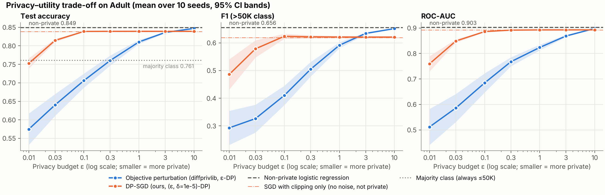

# The privacy–utility trade-off in differentially private machine learning

A small, fully reproducible study: train a logistic-regression income classifier
on the UCI **Adult** dataset with and without **differential privacy (DP)**, sweep
the privacy budget ε from 0.01 to 10, and measure what privacy costs in accuracy,
F1 and ROC-AUC.

* **Paper:** [`paper/paper.md`](paper/paper.md)
* **Metrics:** [`results/metrics_summary.csv`](results/metrics_summary.csv) (per-run rows in `results/metrics_raw.csv`)
* **Figures:** [`results/figures/`](results/figures)

## Headline results (test set of 14,653 people, mean of 10 seeds)

| ε | Objective perturbation (ε-DP) | DP-SGD (ε, δ=10⁻⁵) |
|---|---|---|
| 0.01 | 0.575 acc / 0.293 F1 | 0.753 acc / 0.486 F1 |
| 0.1 | 0.706 / 0.410 | 0.839 / 0.624 |
| 1 | 0.811 / 0.592 | 0.839 / 0.621 |
| 10 | 0.847 / 0.652 | 0.839 / 0.621 |
| non-private | 0.849 / 0.656 (L-BFGS) | 0.848 / 0.650 (same SGD, no DP) |

The majority-class predictor scores 0.761 accuracy. Main findings:

1. **The cost of privacy depends strongly on the mechanism.** DP-SGD loses only about 1
   accuracy point from ε = 0.1 upward. Objective perturbation needs ε ≈ 3–10 to get
   that close, and at ε ≤ 0.3 it does no better than always predicting "≤50K".
2. **In DP-SGD, what's left of the gap comes from clipping, not noise.** From ε ≥ 0.1, DP-SGD
   is indistinguishable from the same optimiser with gradient clipping but *zero* noise
   (0.839). So noise costs almost nothing there, and the leftover ~0.9-point gap is
   clipping bias.
3. **More data makes privacy cheaper.** At ε = 1, objective perturbation's accuracy
   deficit shrinks from 20 points (n = 1,000) to 4 points (n = 34,189).



## Quick start

```bash
python -m venv .venv && source .venv/bin/activate
pip install -r requirements.txt
python -m tests.test_core          # 7 sanity tests (accountant, DP-SGD, data bounds)
python -m src.run_experiments      # full study, ~90 s on a laptop CPU; writes results/
```

Options: `--quick` (2 seeds, smoke test), `--synthetic` (force the synthetic
fallback dataset), `--no-plots`. Figures alone: `python -m src.plots`.

> **Version pins matter.** `diffprivlib 0.6.6` (the latest release at the time of writing)
> fails to import with scikit-learn ≥ 1.6 (`sklearn.tree._tree.DOUBLE` was removed), and
> its logistic regression fails with recent SciPy (`fmin_l_bfgs_b(iprint=...)` was
> removed). `requirements.txt` pins a compatible stack (Python 3.13 tested). If
> diffprivlib still can't be imported, the pipeline skips the objective-perturbation
> model and runs the self-implemented DP-SGD on its own.

**Reproducibility check:** two consecutive full runs produced byte-identical
`metrics_summary.csv` and `size_sweep_summary.csv`. The raw CSVs were identical except
for the wall-clock `fit_seconds` column. Every random choice is seeded: split seed 0;
model seeds 0–9.

## Repository layout

```
src/
  config.py          every hyper-parameter, epsilon grid, seed and path in one place
  data.py            download + checksum, public-schema encoding, synthetic fallback
  rdp_accountant.py  Rényi-DP accountant for the subsampled Gaussian (from scratch)
  dp_sgd.py          DP-SGD logistic regression in NumPy (from scratch)
  models.py          model factory (baselines, diffprivlib, DP-SGD, ablations)
  evaluate.py        accuracy / F1 / ROC-AUC + mean, std, 95% CI aggregation
  plots.py           the four figures
  run_experiments.py end-to-end driver
tests/test_core.py   sanity tests (runs with or without pytest)
data/raw/adult.csv   the dataset (CC BY 4.0), see data/README.md
results/             CSVs, run_info.json (versions, sizes, timing), figures/
paper/paper.md       the write-up
```

## Design decisions (and why)

**Two DP mechanisms instead of one.** diffprivlib *was* available, so the
library-based model is IBM diffprivlib's `LogisticRegression`. It implements **objective
perturbation** (Chaudhuri et al., 2011) and gives pure ε-DP. To cover **DP-SGD**, which is
the standard approach in modern private deep learning, I implemented it by hand in
NumPy (`src/dp_sgd.py`). That code does Poisson subsampling, per-example clipping and
Gaussian noise, and its privacy accountant (`src/rdp_accountant.py`) is also written
from scratch: the exact integer-order RDP bound for the sampled Gaussian mechanism,
plus the RDP→(ε, δ) conversion of Balle et al. (2020). For the TensorFlow-Privacy
MNIST tutorial setting, the accountant reproduces the published ε = 3.01 (this is a
unit test).

**Preprocessing must not leak.** Fitting a `StandardScaler` or a `OneHotEncoder` on
the training data would release data-dependent statistics outside the privacy
guarantee. Instead, numeric features are clipped and min-max scaled using fixed,
documented domain bounds (for example, age 17–90). Capital gain and capital loss get
`log1p` first. Categoricals are one-hot encoded against the fixed vocabularies in
the UCI documentation, with an extra `Unknown` slot. This gives a public bound
‖x‖₂ ≤ √12 for every row, which is passed to diffprivlib as `data_norm`. Nothing
data-dependent enters a private model. (`fnlwgt` is dropped because it's a census
sampling weight. `education` is dropped because it duplicates `education_num`.)

**Matched non-private references.** Each private model is compared with its own
non-private counterpart: L-BFGS logistic regression for objective perturbation, and
the same SGD schedule without clipping or noise for DP-SGD. A **clipping-only**
ablation then separates the bias from clipping from the cost of the noise.

**Hyper-parameters fixed up front, not tuned per ε.** Tuning on private data spends
privacy budget too (Papernot & Steinke, 2022). DP-SGD uses textbook defaults for
every ε: expected lot size 256, 10 epochs, learning rate 0.5, clip norm C = 1,
δ = 10⁻⁵ < 1/n. The paper's limitations section discusses this.

**Honest statistics.** Every private configuration runs with 10 seeds. Results are
reported as mean ± std, with 95% confidence intervals in the CSVs and as bands in
the figures. Besides accuracy, the study reports F1 for the positive class, because
24% of people are positive and a collapsed model can still reach 76% accuracy. It
also reports ROC-AUC, which doesn't depend on a decision threshold.

## Experiments

1. **ε sweep** on the full training set (34,189 rows) with ε ∈ {0.01, 0.03, 0.1, 0.3,
   1, 3, 10}. Models: objective perturbation and DP-SGD, plus the baselines
   (majority class, non-private logistic regression, non-private SGD, clipping-only SGD).
2. **Training-set size sweep:** n ∈ {1,000, 3,000, 10,000, 34,189} at ε ∈ {0.1, 1},
   with 5 seeds.

## Figures

| File | Content |
|---|---|
| `fig1_metrics_vs_epsilon.png` | accuracy / F1 / AUC vs ε, with non-private, clipping-only and majority references |
| `fig2_baseline_vs_private.png` | bar comparison at ε = 0.1, 1 and 10 vs non-private, per algorithm family |
| `fig3_size_sweep.png` | accuracy vs training-set size at ε = 0.1 and ε = 1 |
| `fig4_noise_multiplier.png` | DP-SGD noise multiplier σ chosen by the accountant for each ε |
