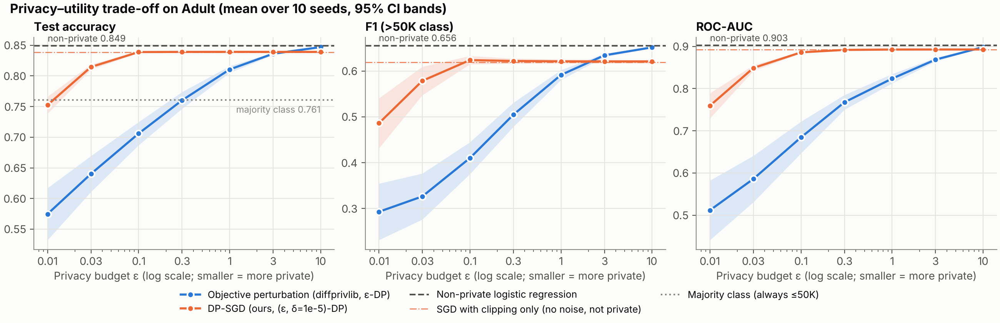
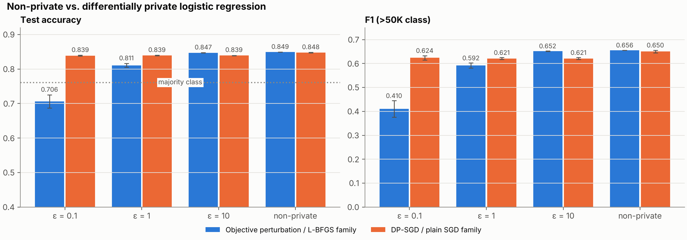
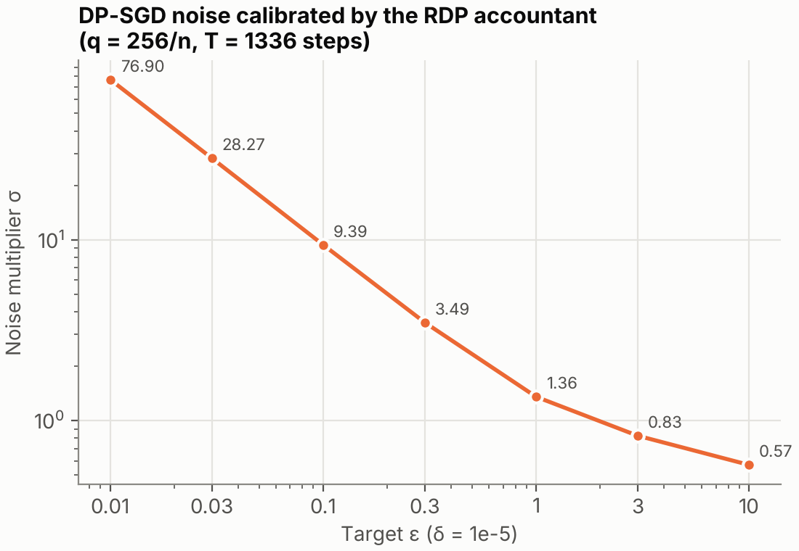
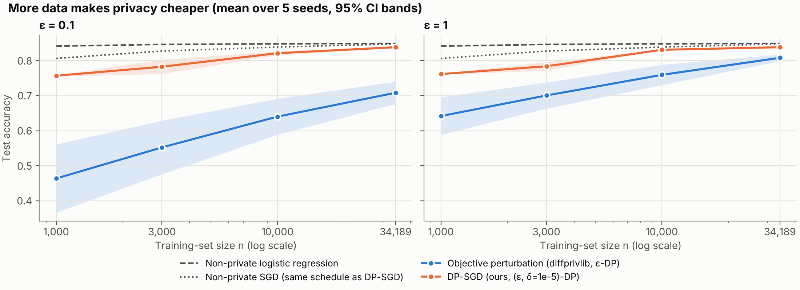

# The Privacy–Utility Trade-off in Differentially Private Machine Learning: An Empirical Study of Objective Perturbation and DP-SGD on Census Income Data

*Reproducible mini-project. All code, data and raw results are in this repository. Every number below is read directly from `results/metrics_summary.csv` and `results/size_sweep_summary.csv`.*

## Abstract

Differential privacy (DP) is the standard formal definition for training machine-learning models on sensitive personal data, but its guarantees come at a cost in model quality. We measure that cost on a concrete task: predicting whether a person earns more than $50K from the UCI Adult census dataset (48,842 records). We train a logistic-regression classifier without privacy and with two DP mechanisms: *objective perturbation* (pure ε-DP, via IBM's diffprivlib) and *DP-SGD* ((ε, δ)-DP with δ = 10⁻⁵, implemented from scratch together with a Rényi-DP accountant). We sweep the privacy budget ε from 0.01 to 10 over 10 random seeds. The non-private model reaches 84.9% test accuracy (F1 0.656, ROC-AUC 0.903). The trade-off depends strongly on the mechanism. DP-SGD stays within about 1 accuracy point of the baseline for all ε ≥ 0.1 (83.9%) and is still above the 76.1% majority-class rate at ε = 0.03 (81.5%). Objective perturbation loses 3.9 points at ε = 1 and only approaches the baseline at ε = 10 (84.7%); for ε ≤ 0.3 it is no better than always predicting the majority class. An ablation shows that DP-SGD's residual gap at moderate and large ε comes entirely from per-example gradient *clipping*, not from the added noise. A training-set-size sweep confirms that privacy gets cheaper with more data: at ε = 1, objective perturbation's accuracy deficit falls from 20.0 points with 1,000 training records to 4.1 points with 34,189. We discuss what these results do and do not imply for practitioners choosing ε.

## 1 Introduction

Models trained on personal data can leak that data. Membership-inference attacks can tell whether a specific person was in a model's training set (Shokri et al., 2017), and model-inversion attacks can reconstruct sensitive attributes (Fredrikson et al., 2015). Removing names before training does not stop this, because the leak happens through the learned parameters themselves.

Differential privacy (Dwork et al., 2006) offers a principled defence. It bounds how much any single individual's record can change the distribution of the trained model, and therefore what any attacker can learn about that individual from the model, whatever side information the attacker has. A single parameter, the privacy budget ε, controls the strength of the guarantee: smaller ε means stronger privacy. DP has moved from theory into deployment, including the 2020 U.S. Census (Abowd, 2018) and large-scale telemetry (Erlingsson et al., 2014).

The guarantee is not free. DP mechanisms inject calibrated randomness, and that randomness reduces model accuracy. This *privacy–utility trade-off* is the central practical question in private machine learning: for a given ε, how much accuracy do we give up, and how does the answer depend on the algorithm and the amount of data?

This report answers that question empirically for a small, standard and realistic setting: a tabular census dataset, where privacy is a natural concern, and a logistic-regression classifier. Our contributions are:

1. A reproducible pipeline that trains non-private and DP logistic regression on Adult and sweeps ε ∈ {0.01, 0.03, 0.1, 0.3, 1, 3, 10}. It uses 10 seeds per setting and reports accuracy, F1 and ROC-AUC with 95% confidence intervals.
2. A comparison of two DP training paradigms. Objective perturbation comes from an established library (diffprivlib). DP-SGD is a transparent from-scratch NumPy implementation whose Rényi-DP accountant reproduces a published reference value.
3. Ablations that explain the shape of the curves. A matched non-private SGD and a clipping-only variant separate the cost of *noise* from the cost of *clipping*, and a training-set-size sweep shows how the trade-off scales with data.
4. A privacy-aware preprocessing design. All feature scaling comes from public domain bounds, so no data-dependent statistic escapes the privacy accounting.

## 2 Background

### 2.1 Differential privacy

Two datasets *D* and *D′* are *neighbouring* if they differ in one individual's record. A randomised algorithm *M* is **(ε, δ)-differentially private** (Dwork et al., 2006; Dwork & Roth, 2014) if, for all neighbouring *D*, *D′* and every set of outcomes *S*,

  Pr[*M*(*D*) ∈ *S*] ≤ e^ε · Pr[*M*(*D′*) ∈ *S*] + δ.

With δ = 0 this is *pure* ε-DP. Intuitively, any conclusion an observer draws from the output is almost equally likely whether or not a given person's data was used. DP has three properties that matter in practice. It is immune to *post-processing*: nothing computed from a DP output can weaken the guarantee. It *composes*: running several DP computations adds up their budgets. And it holds against adversaries with arbitrary auxiliary information.

### 2.2 The privacy budget ε

ε bounds the multiplicative change in output probabilities. An equivalent reading is that a hypothesis test trying to decide "was Alice in the data?" has a true-positive rate no higher than e^ε times its false-positive rate, plus δ. Values below about 1 are generally considered strong protection. Values of 1–10 are common in deployments and give weaker but still meaningful worst-case bounds. Values much larger than 10 offer little formal protection. δ is a small probability of the bound failing and should be much smaller than 1/n. With n ≈ 34,000 training records we use δ = 10⁻⁵.

The basic tool for achieving DP is to bound the *sensitivity* of a computation, meaning the most one record can change it, and then add noise scaled to sensitivity/ε. The Laplace mechanism does this for pure ε-DP and the Gaussian mechanism for (ε, δ)-DP (Dwork & Roth, 2014).

### 2.3 Private empirical risk minimisation: objective perturbation

For a convex model such as logistic regression, *objective perturbation* (Chaudhuri et al., 2011; Kifer et al., 2012) adds a random linear term bᵀw/n to the regularised training objective and then solves the perturbed problem exactly. The noise vector *b* has a norm drawn from a Gamma distribution with scale proportional to (data-norm bound)/ε′ and shape equal to the dimension *d*. The guarantee is pure ε-DP, but it requires a convex, smooth loss and a *public* bound on ‖x‖. Part of the budget is consumed by the curvature of the loss. In diffprivlib's implementation (Holohan et al., 2019), ε′ = ε − 2 ln(1 + 0.25·‖x‖_max/λ). When that quantity is not positive, the implementation adds extra regularisation and uses ε′ = ε/2. The norm of the injected noise grows linearly with *d* and shrinks with *n*.

### 2.4 DP-SGD

DP-SGD (Song et al., 2013; Bassily et al., 2014; Abadi et al., 2016) makes ordinary stochastic gradient descent private. At each step it:

1. samples a "lot" of training examples, each independently with probability *q* (Poisson sampling);
2. computes each example's gradient and *clips* it to L2 norm at most *C*, which bounds every individual's influence on the update;
3. adds Gaussian noise N(0, σ²C²I) to the sum of clipped gradients;
4. takes a gradient step with the noisy average.

The noise multiplier σ is chosen so that all *T* steps together satisfy (ε, δ)-DP. The tightest practical way to track this budget is **Rényi DP** (Mironov, 2017). For the subsampled Gaussian mechanism, the RDP at integer order α has an exact closed form (Mironov et al., 2019). RDP composes additively over steps and is then converted to (ε, δ)-DP (Balle et al., 2020). Subsampling *amplifies* privacy: each record participates in only a fraction *q* of the steps, so far less noise is needed than in full-batch training.

### 2.5 The privacy–utility trade-off

Theory predicts that the excess risk of private convex ERM scales roughly as O(√d/(nε)) for the best mechanisms (Bassily et al., 2014). The utility cost should therefore fall as ε grows and as *n* grows, and rise with dimension. In practice, constants, clipping bias, hyper-parameter choices and the specific mechanism dominate. Empirical studies have found large gaps between mechanisms and between theory and practice (Jayaraman & Evans, 2019; Tramèr & Boneh, 2021). The size of the trade-off on a given task is therefore an empirical question, which is the one we study.

## 3 Methodology

### 3.1 Data

We use the UCI Adult dataset (Becker & Kohavi, 1996; Kohavi, 1996): 48,842 census records with 14 attributes and a binary label for income > $50K (23.9% positive). The original train/test files are concatenated and split once into a stratified 70/30 train/test partition (seed 0), giving 34,189 training and 14,653 test records. The test set never influences training.

**Privacy-aware encoding.** Standard preprocessing such as standardisation or vocabulary discovery computes statistics of the private data, and those statistics would sit outside the DP guarantee. We therefore derive the entire feature map from public metadata:

* Five numeric attributes (age, education_num, hours_per_week, capital_gain, capital_loss) are clipped to documented domain bounds (for example, age ∈ [17, 90] and capital_gain ∈ [0, 99,999]) and min-max scaled to [0, 1] using *those bounds*. The two heavy-tailed money attributes are `log1p`-transformed first.
* Seven categorical attributes are one-hot encoded against the fixed vocabularies in the UCI documentation, with an extra `Unknown` slot for missing values ("?").
* `fnlwgt` (a census sampling weight) and `education` (a 1:1 duplicate of `education_num`) are dropped.

The result has 95 features. Every encoded row satisfies ‖x‖₂ ≤ √(5 + 7) = √12 ≈ 3.46: each numeric feature is at most 1, and each categorical group has exactly one active slot. This *public* bound is the `data_norm` given to objective perturbation, and the code asserts that it holds.

### 3.2 Models

| Model | Privacy | Implementation |
|---|---|---|
| Majority class | none (reference) | scikit-learn `DummyClassifier` |
| Non-private logistic regression | none | scikit-learn, L-BFGS, C = 1 |
| **Objective perturbation** | ε-DP (δ = 0) | diffprivlib 0.6.6 `LogisticRegression`, C = 1, `data_norm` = √12 |
| Non-private SGD | none (reference) | our NumPy SGD, same schedule as DP-SGD, no clipping or noise |
| SGD, clipping only | none (ablation) | our NumPy SGD with per-example clipping, σ = 0 |
| **DP-SGD** | (ε, 10⁻⁵)-DP | our NumPy DP-SGD + RDP accountant |

All models are linear (95 weights plus a bias), which keeps every run under a second.

**DP-SGD details.** We use Poisson sampling with expected lot size L = 256 (q = 256/34,189 ≈ 0.0075), 10 epochs (T = ⌈10/q⌉ = 1,336 steps), a constant learning rate of 0.5, clip norm C = 1 and weight decay 10⁻⁴. The noisy gradient sum is divided by the *expected* lot size L, not the realised one, because the realised lot size is itself private. For each target ε, σ is found by bisection: it is the smallest σ for which our accountant certifies ε at δ = 10⁻⁵, rounded to the conservative side. The accountant evaluates the exact integer-order RDP of the sampled Gaussian mechanism over orders α ∈ {2, …, 64, 80, …, 4096} and applies the Balle et al. (2020) conversion. As a correctness check, our unit tests confirm that the accountant reproduces ε = 3.01, the value published in the TensorFlow Privacy MNIST tutorial (n = 60,000, L = 256, σ = 1.1, 60 epochs, classic conversion). Our tighter conversion gives 2.60 for the same setting.

**Hyper-parameters** are fixed a priori from standard defaults and are *the same for every ε*. We did not tune per ε, because tuning on private data consumes privacy budget that would then need to be accounted for (Papernot & Steinke, 2022).

### 3.3 Protocol and metrics

Experiment 1 (the ε sweep) trains each private model at each ε ∈ {0.01, 0.03, 0.1, 0.3, 1, 3, 10} with seeds 0–9. The randomised non-private references (non-private SGD and clipping-only SGD) also use 10 seeds; the deterministic baselines run once. Experiment 2 (the size sweep) trains on random subsets of n ∈ {1,000, 3,000, 10,000, 34,189} training records at ε ∈ {0.1, 1} with 5 seeds and evaluates on the same full test set.

We report test **accuracy**, **F1** for the positive (>50K) class, and **ROC-AUC**. F1 is essential here: a model that collapses to always predicting "≤50K" scores 76.1% accuracy but F1 = 0. ROC-AUC is threshold-free and equals 0.5 for an uninformative scorer. We report means over seeds, standard deviations, and 95% confidence intervals (1.96·std/√seeds).

The whole pipeline (`python -m src.run_experiments`) runs in about 90 seconds on a CPU. Two consecutive runs produced byte-identical summary files.

## 4 Experiments and Results

### 4.1 Reference points

The non-private logistic regression reaches **0.849 accuracy, 0.656 F1 and 0.903 ROC-AUC**. Our non-private SGD with the DP-SGD schedule is almost as good (0.848 ± 0.001 accuracy, 0.650 F1, 0.900 AUC), so the optimiser itself costs essentially nothing. The majority-class predictor scores 0.761 accuracy. This is the floor below which a model is worse than useless.

### 4.2 Accuracy, F1 and AUC versus ε

Table 1 and Figure 1 show the main result.

**Table 1.** Test metrics, mean ± std over 10 seeds. Δacc is the change in accuracy against the non-private logistic regression (0.849), in percentage points.

| ε | Obj. pert. acc | Obj. pert. F1 | Obj. pert. AUC | Δacc | DP-SGD acc | DP-SGD F1 | DP-SGD AUC | Δacc | DP-SGD σ |
|---|---|---|---|---|---|---|---|---|---|
| 0.01 | 0.575 ± 0.068 | 0.293 ± 0.099 | 0.512 ± 0.114 | −27.5 | 0.753 ± 0.022 | 0.486 ± 0.088 | 0.760 ± 0.048 | −9.7 | 76.90 |
| 0.03 | 0.640 ± 0.047 | 0.326 ± 0.081 | 0.586 ± 0.089 | −20.9 | 0.815 ± 0.007 | 0.579 ± 0.050 | 0.849 ± 0.011 | −3.5 | 28.27 |
| 0.1 | 0.706 ± 0.031 | 0.410 ± 0.056 | 0.684 ± 0.061 | −14.3 | 0.839 ± 0.002 | 0.624 ± 0.015 | 0.886 ± 0.003 | −1.0 | 9.39 |
| 0.3 | 0.760 ± 0.022 | 0.505 ± 0.042 | 0.768 ± 0.028 | −8.9 | 0.839 ± 0.001 | 0.622 ± 0.009 | 0.892 ± 0.001 | −1.0 | 3.49 |
| 1 | 0.811 ± 0.009 | 0.592 ± 0.017 | 0.824 ± 0.018 | −3.9 | 0.839 ± 0.001 | 0.621 ± 0.007 | 0.893 ± 0.001 | −1.0 | 1.36 |
| 3 | 0.836 ± 0.003 | 0.634 ± 0.006 | 0.869 ± 0.007 | −1.3 | 0.839 ± 0.001 | 0.621 ± 0.007 | 0.893 ± 0.000 | −1.0 | 0.83 |
| 10 | 0.847 ± 0.001 | 0.652 ± 0.002 | 0.898 ± 0.001 | −0.2 | 0.839 ± 0.001 | 0.621 ± 0.006 | 0.893 ± 0.000 | −1.0 | 0.57 |
| ∞ (non-private) | 0.849 | 0.656 | 0.903 | 0 | 0.848 ± 0.001 | 0.650 ± 0.009 | 0.900 ± 0.000 | −0.15 | 0 |

**Figure 1.** Accuracy, F1 and ROC-AUC against ε (log scale). Bands are 95% confidence intervals over 10 seeds. Dashed: non-private logistic regression. Dash-dotted orange: SGD with clipping but no noise. Dotted: majority class.

Four observations stand out.

**(i) Utility falls monotonically as privacy gets stronger, but the shape of the curve depends on the mechanism.** For objective perturbation the curve is smooth and wide. Accuracy climbs from 0.575 at ε = 0.01 to 0.847 at ε = 10, and almost every tenfold increase in ε recovers a large share of the remaining gap. For DP-SGD the curve has a sharp knee. Accuracy is 0.753 at ε = 0.01 and 0.815 at ε = 0.03, then flat at 0.839 from ε = 0.1 to 10.

**(ii) At strong privacy (ε ≤ 1), DP-SGD dominates.** At ε = 0.1 DP-SGD achieves 0.839 accuracy and 0.624 F1, against 0.706 and 0.410 for objective perturbation. Objective perturbation stays *below the 0.761 majority-class accuracy* for ε ≤ 0.1 and only draws level with it at ε = 0.3 (0.760). In other words, at those budgets the injected noise overwhelms the signal. Its ROC-AUC at ε = 0.01 (0.512 ± 0.114) is indistinguishable from chance. DP-SGD is also far more *stable*: at ε = 0.1 its accuracy standard deviation is 0.002, against 0.031 for objective perturbation.

**(iii) At weak privacy (ε ≥ 3), objective perturbation catches up and overtakes DP-SGD.** The F1 curves cross between ε = 1 and ε = 3 (0.634 vs 0.621 at ε = 3), and the accuracy curves cross between ε = 3 and ε = 10. At ε = 10, objective perturbation is within 0.2 points of the non-private baseline (0.847), while DP-SGD stays at 0.839.

**(iv) DP-SGD's plateau is the clipping-only model.** SGD with per-example clipping and *no noise at all* scores 0.839 ± 0.001 accuracy, 0.619 F1 and 0.893 AUC. These values match DP-SGD at every ε ≥ 0.1 to within the confidence intervals (Figure 1, dash-dotted line). So for this task and schedule, the Gaussian noise costs nothing measurable once ε ≥ 0.1. The whole remaining gap to non-private SGD (0.9 accuracy points and 3.1 F1 points) is caused by clipping with C = 1, which biases the gradient direction (Chen et al., 2020). Noise only becomes the dominant cost below ε = 0.1, where σ grows to 28 (ε = 0.03) and 77 (ε = 0.01).

**Figure 2.** Accuracy and F1 at ε = 0.1, 1 and 10 compared with each algorithm family's non-private counterpart. Error bars are 95% confidence intervals.

Figure 2 summarises the comparison with the non-private baseline. For DP-SGD, the cost of going from a non-private model to ε = 0.1, which is very strong privacy, is 0.9 accuracy points against its own non-private SGD (0.848 → 0.839). For objective perturbation, the same move costs 14.3 points (0.849 → 0.706).

### 4.3 How the noise is calibrated

**Figure 4.** DP-SGD noise multiplier σ chosen by our accountant for each ε (T = 1,336 steps, q ≈ 0.0075, δ = 10⁻⁵).

σ ranges from 76.9 at ε = 0.01 to 0.57 at ε = 10, roughly inversely proportional to ε when ε is small. The noise in the *averaged* gradient has a per-coordinate standard deviation of σC/L. That is 0.037 at ε = 0.1 and 0.005 at ε = 1, small next to the clipped gradients. It is also further averaged over 1,336 steps. This explains why the noise has no measurable effect for ε ≥ 0.1. Subsampling amplification does most of the work. Each record takes part in a lot only with probability 0.0075, so the per-step privacy loss is tiny and compounds slowly.

### 4.4 Effect of training-set size

**Figure 3.** Test accuracy against the number of training records at ε = 0.1 and ε = 1, mean of 5 seeds with 95% confidence bands. Dotted: non-private SGD with the same schedule as DP-SGD.

**Table 2.** Test accuracy (mean of 5 seeds) against training-set size.

| n | Non-private LR | Non-private SGD | Obj. pert. ε = 0.1 | Obj. pert. ε = 1 | DP-SGD ε = 0.1 | DP-SGD ε = 1 |
|---|---|---|---|---|---|---|
| 1,000 | 0.842 | 0.807 | 0.464 | 0.642 | 0.757 | 0.762 |
| 3,000 | 0.846 | 0.828 | 0.552 | 0.701 | 0.783 | 0.784 |
| 10,000 | 0.848 | 0.839 | 0.640 | 0.760 | 0.821 | 0.831 |
| 34,189 | 0.849 | 0.848 | 0.708 | 0.808 | 0.839 | 0.838 |

The non-private model barely benefits from more data (0.842 → 0.849), but the private models benefit a great deal. At ε = 1, objective perturbation's deficit against non-private logistic regression shrinks from 20.0 points (n = 1,000) to 14.6, 8.9 and finally 4.1 points (n = 34,189). At ε = 0.1 it improves from 0.464 to 0.708 but never reaches the majority-class rate. This is the expected behaviour: the injected noise term is divided by *n*, so the same ε "costs" less utility with more people in the data.

For DP-SGD at small *n*, two effects combine, and the matched non-private SGD separates them. With a fixed budget of 10 epochs and L = 256, n = 1,000 gives only 40 optimisation steps, so even *non-private* SGD reaches only 0.807. DP-SGD at ε = 1 loses a further 4.5 points (0.762), with F1 0.013, which means it predicts almost only the majority class. By n = 10,000 the gap to the matched non-private SGD is 0.8 points (0.831 vs 0.839) at ε = 1. At full size it is 0.9 points, which is the clipping bias identified in Section 4.2. Privacy is cheap only when there is enough data.

(The n = 34,189 rows of Table 2 use 5 seeds and a random permutation of the training set, so they differ from Table 1 by at most 0.3 points.)

## 5 Discussion and Limitations

**What the results mean for practitioners.** On this task a strong guarantee is affordable. DP-SGD at ε = 0.1, a budget well inside the "strong privacy" range, keeps 98.8% of the non-private accuracy (0.839/0.849) and 95% of its F1 (0.624/0.656). Choosing a DP mechanism is at least as important as choosing ε, though. At ε = 0.1 the two mechanisms we tested differ by 13 accuracy points, and one of them is worse than a constant predictor. Reporting "accuracy at ε" without naming the mechanism, the data size and the hyper-parameters says little. The crossover at large ε also shows that no mechanism is uniformly best. Objective perturbation solves the ERM problem exactly and has no clipping bias, so it wins once its noise term becomes small (ε ≥ 3 on this data).

**Why does objective perturbation fall behind at small ε?** Three factors in the mechanism itself plausibly contribute; we did not test each one separately. (a) Its noise norm grows linearly with dimension (Gamma with shape *d* = 96), whereas the Gaussian noise in DP-SGD grows like √*d*. (b) It must use the worst-case data-norm bound (√13 including the intercept), while DP-SGD controls sensitivity through C = 1. (c) For ε < 2 ln(1 + 0.25·√13) ≈ 1.29, diffprivlib's implementation halves the effective budget and adds extra regularisation. On the other side, DP-SGD benefits from privacy amplification by subsampling and from a δ > 0 relaxation.

**Comparability of guarantees.** The two mechanisms give *different* guarantees. Objective perturbation is pure ε-DP (δ = 0), which is strictly stronger than DP-SGD's (ε, 10⁻⁵)-DP at the same ε. The literature also uses two slightly different neighbouring relations: replace-one for objective perturbation (Chaudhuri et al., 2011) and add/remove-one for our DP-SGD accountant. Comparing them at equal ε is the standard practical framing, but it is not exactly apples to apples.

**Limitations.**

* *Hyper-parameters were not tuned under privacy.* All DP-SGD settings (C = 1, L = 256, 10 epochs, lr = 0.5) are fixed defaults. A smaller clip norm, or adaptive clipping, might remove part of the 0.9-point clipping bias. A properly accounted private hyper-parameter search (Papernot & Steinke, 2022) was out of scope. Each model was also run on the data during development as a smoke test (no settings were changed as a result); such interactions with the data are not formally accounted, as is usual in DP research but not acceptable in a real deployment.
* *The public-schema assumption.* Our preprocessing treats feature bounds and category vocabularies as public. That is reasonable for census-coded data, but it must be justified case by case.
* *Only linear models and one dataset.* Logistic regression on 95 features is the most favourable regime for DP: low dimension, convex, and a large *n*/*d* ratio. Deep networks with millions of parameters show much larger utility losses (Abadi et al., 2016; Tramèr & Boneh, 2021), and our results should not be extrapolated to them.
* *Aggregate metrics hide disparate impact.* DP is known to reduce accuracy more for under-represented groups (Bagdasaryan et al., 2019). Adult contains sensitive attributes (sex, race), and a per-group analysis is the natural next step.
* *No empirical privacy audit.* We rely on the formal guarantees and do not run membership-inference attacks to measure how much protection the models actually give (Jayaraman & Evans, 2019; Nasr et al., 2021). The accountant is validated against a published value, but implementation bugs in DP code are possible in general.
* *Single train/test split.* Seeds vary the mechanism's randomness, not the data split. The very narrow confidence intervals of DP-SGD therefore understate split-to-split variation.
* *Floating-point caveat.* Like most research DP code, ours samples noise with standard floating-point generators, which do not exactly implement the idealised continuous mechanisms.

## 6 Conclusion

We measured the privacy–utility trade-off of differentially private logistic regression on the Adult census data across three orders of magnitude of ε. Utility falls monotonically as privacy gets stronger, but how fast it falls depends heavily on the mechanism and on the amount of data. With DP-SGD, strong privacy (ε = 0.1) costs about one accuracy point (0.849 → 0.839). An ablation shows that this cost comes from gradient clipping rather than noise. With objective perturbation, the same budget costs 14 points; the method needs ε ≈ 3–10 to approach the baseline, but there it beats DP-SGD. More training data shrinks the price of privacy steadily: going from 1,000 to 34,189 records cuts objective perturbation's accuracy deficit at ε = 1 from 20.0 to 4.1 points. The practical lesson is that ε alone does not determine the cost of privacy. The mechanism, its clipping and noise calibration, and the number of people in the data matter just as much, and with the right choices strong formal privacy can be nearly free for simple models on moderately sized tabular data.

## References

1. Abadi, M., Chu, A., Goodfellow, I., McMahan, H. B., Mironov, I., Talwar, K., & Zhang, L. (2016). Deep learning with differential privacy. *Proceedings of the ACM SIGSAC Conference on Computer and Communications Security (CCS)*, 308–318.
2. Abowd, J. M. (2018). The U.S. Census Bureau adopts differential privacy. *Proceedings of the 24th ACM SIGKDD International Conference on Knowledge Discovery & Data Mining*, 2867.
3. Bagdasaryan, E., Poursaeed, O., & Shmatikov, V. (2019). Differential privacy has disparate impact on model accuracy. *Advances in Neural Information Processing Systems (NeurIPS) 32*.
4. Balle, B., Barthe, G., Gaboardi, M., Hsu, J., & Sato, T. (2020). Hypothesis testing interpretations and Rényi differential privacy. *Proceedings of the 23rd International Conference on Artificial Intelligence and Statistics (AISTATS)*, 2496–2506.
5. Bassily, R., Smith, A., & Thakurta, A. (2014). Private empirical risk minimization: Efficient algorithms and tight error bounds. *IEEE 55th Annual Symposium on Foundations of Computer Science (FOCS)*, 464–473.
6. Becker, B., & Kohavi, R. (1996). Adult [Dataset]. UCI Machine Learning Repository. https://doi.org/10.24432/C5XW20
7. Chaudhuri, K., Monteleoni, C., & Sarwate, A. D. (2011). Differentially private empirical risk minimization. *Journal of Machine Learning Research*, 12, 1069–1109.
8. Chen, X., Wu, S. Z., & Hong, M. (2020). Understanding gradient clipping in private SGD: A geometric perspective. *Advances in Neural Information Processing Systems (NeurIPS) 33*.
9. Dwork, C., McSherry, F., Nissim, K., & Smith, A. (2006). Calibrating noise to sensitivity in private data analysis. *Theory of Cryptography Conference (TCC)*, LNCS 3876, 265–284.
10. Dwork, C., & Roth, A. (2014). The algorithmic foundations of differential privacy. *Foundations and Trends in Theoretical Computer Science*, 9(3–4), 211–407.
11. Erlingsson, Ú., Pihur, V., & Korolova, A. (2014). RAPPOR: Randomized aggregatable privacy-preserving ordinal response. *Proceedings of the ACM SIGSAC Conference on Computer and Communications Security (CCS)*, 1054–1067.
12. Fredrikson, M., Jha, S., & Ristenpart, T. (2015). Model inversion attacks that exploit confidence information and basic countermeasures. *Proceedings of the ACM SIGSAC Conference on Computer and Communications Security (CCS)*, 1322–1333.
13. Holohan, N., Braghin, S., Mac Aonghusa, P., & Levacher, K. (2019). Diffprivlib: The IBM differential privacy library. *arXiv:1907.02444*.
14. Jayaraman, B., & Evans, D. (2019). Evaluating differentially private machine learning in practice. *28th USENIX Security Symposium*, 1895–1912.
15. Kifer, D., Smith, A., & Thakurta, A. (2012). Private convex empirical risk minimization and high-dimensional regression. *Proceedings of the 25th Annual Conference on Learning Theory (COLT)*, PMLR 23, 25.1–25.40.
16. Kohavi, R. (1996). Scaling up the accuracy of naive-Bayes classifiers: A decision-tree hybrid. *Proceedings of the Second International Conference on Knowledge Discovery and Data Mining (KDD)*, 202–207.
17. Mironov, I. (2017). Rényi differential privacy. *IEEE 30th Computer Security Foundations Symposium (CSF)*, 263–275.
18. Mironov, I., Talwar, K., & Zhang, L. (2019). Rényi differential privacy of the sampled Gaussian mechanism. *arXiv:1908.10530*.
19. Nasr, M., Song, S., Thakurta, A., Papernot, N., & Carlini, N. (2021). Adversary instantiation: Lower bounds for differentially private machine learning. *IEEE Symposium on Security and Privacy (S&P)*, 866–882.
20. Papernot, N., & Steinke, T. (2022). Hyperparameter tuning with Rényi differential privacy. *International Conference on Learning Representations (ICLR)*.
21. Shokri, R., Stronati, M., Song, C., & Shmatikov, V. (2017). Membership inference attacks against machine learning models. *IEEE Symposium on Security and Privacy (S&P)*, 3–18.
22. Song, S., Chaudhuri, K., & Sarwate, A. D. (2013). Stochastic gradient descent with differentially private updates. *IEEE Global Conference on Signal and Information Processing (GlobalSIP)*, 245–248.
23. Tramèr, F., & Boneh, D. (2021). Differentially private learning needs better features (or much more data). *International Conference on Learning Representations (ICLR)*.
